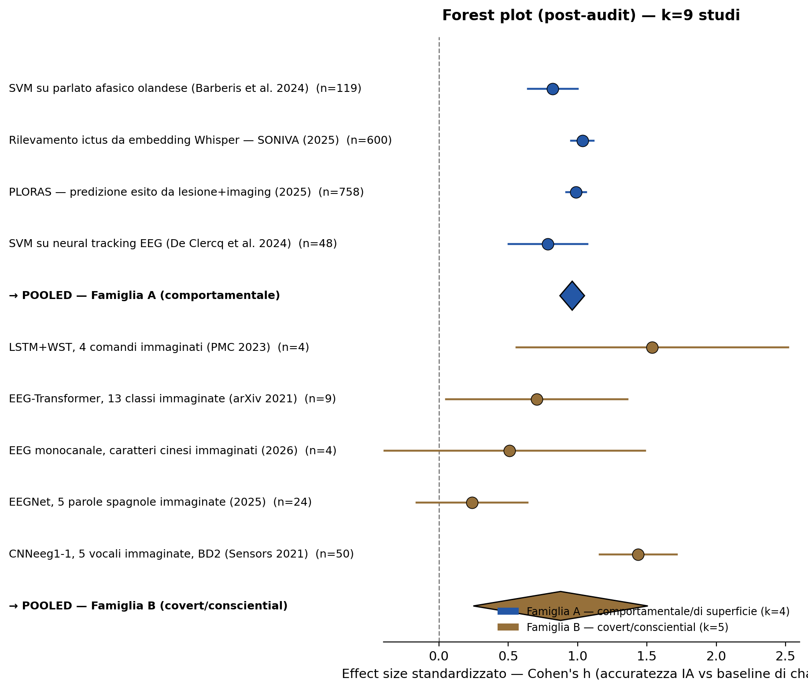

# Da knowledge graph a meta-analisi statistica: l'IA tra comportamento osservabile ed eventi coscienziali dell'afasia

## 1. Perché quello che abbiamo costruito finora NON è una meta-analisi

Va detto con chiarezza, perché è il punto di partenza corretto: l'ontologia e il knowledge graph mappano *categoricamente* 33 strumenti (chi fa cosa, con quale tecnica, con quale livello di evidenza dichiarato). Una **meta-analisi statistica** è un'altra cosa, metodologicamente più stringente: prende un insieme di studi che misurano *lo stesso costrutto* con *misure comparabili*, calcola un **effect size** standardizzato per ciascuno (Cohen's d, Hedges' g, odds ratio, correlazione r...), e li combina in un **modello statistico** (a effetti fissi o casuali) per stimare un effetto medio pooled, con intervallo di confidenza, test di eterogeneità (I², Q di Cochran) e — idealmente — un funnel plot per il publication bias. Segue il protocollo PRISMA.

Nel campo dell'afasia esistono meta-analisi classiche di riferimento, utili come modello metodologico diretto:

- **Robey (1994, 1998)**, le meta-analisi fondative: l'ES medio per il recupero non trattato in fase acuta era 0,63; il trattamento logopedico mostra superiorità chiara rispetto al non trattamento su 55 studi.
- **Harmon et al. (2019)**, *Benchmarks of Significant Change*: meta-analisi a effetti casuali separata per disegni within-group e between-group, con ES pooled su tre misure standard — WAB-AQ (5,03 punti within-group; 5,05 between-group), CETI (10,37 punti), Boston Naming Test (3,30 punti within-group; 0,55 between-group, **non significativo**). Segue PRISMA.
- **Meta-analisi di rete (network meta-analysis) su dosaggio/intensità/frequenza** (Stroke, IPD-based): usa dati a livello di singolo partecipante invece che solo aggregati, per confrontare regimi terapeutici diversi.
- **Meta-analisi sulla Melodic Intonation Therapy** e sui **trattamenti di word-finding** (ES=0,48 mantenuto a 3 mesi): mostrano come il campo scomponga sistematicamente l'efficacia per tipo di trattamento.

Questo è il livello di rigore a cui una vera meta-analisi sugli strumenti IA dovrebbe puntare — non semplicemente "quanti strumenti esistono" ma "quanto, in media, funzionano, con quanta certezza statistica, e cosa modera questa efficacia".

## 2. Cosa intende il professore con "eventi coscienziali" — e perché è un'osservazione più acuta di quanto sembri

La frase "imitare e comprendere gli eventi coscienziali dell'afasia" non è vaga: corrisponde a un filone di ricerca reale e attivo, distinto da (e complementare a) tutto ciò che abbiamo mappato finora. Il punto chiave, documentato in letteratura, è questo:

> **Nell'afasia, il linguaggio interiore (inner speech) è spesso preservato meglio del linguaggio parlato.**

Goodglass et al. (1976) osservarono che persone con afasia di Broca e di conduzione riportavano di "avere l'idea della parola" (il fenomeno *tip-of-the-tongue*) pur non riuscendo a pronunciarla, con una consapevolezza fonologica del target relativamente intatta. Fama et al. (2017, 2019, 2020) e Sierpowska et al. (2020) hanno confermato sistematicamente che l'abilità di *inner speech* può eccedere quella di produzione articolata anche in afasie severe. Langland-Hassan et al. (2015) hanno formalizzato lo studio dei "deficit di linguaggio interiore nell'afasia" come programma di ricerca a sé. Uno studio del 2024 (Alexander, Hedrick & Stark, *Frontiers in Psychology*) ha persino trovato, con experience sampling quotidiano su 23 persone con afasia cronica, che il linguaggio interiore è presente nell'**78% dei momenti campionati**, usato soprattutto per ricordare, pianificare e automotivarsi — indipendentemente dalla gravità dell'afasia.

Questo significa che **l'evento cosciente linguistico (l'intenzione, l'idea della parola, il "sapere cosa dire") spesso sopravvive alla rottura del canale che lo traduce in parola udibile.** È esattamente la distinzione clinica tra competenza e prestazione applicata al piano fenomenologico, non solo comportamentale.

## 3. Il gap che questo rivela nella nostra mappatura attuale

Dei 33 strumenti mappati nel knowledge graph, la stragrande maggioranza — inclusi tutti quelli terapeutici e diagnostici basati su ASR/NLP/LLM — lavora esclusivamente sul **canale comportamentale osservabile**: trascrive, classifica o genera a partire dal parlato *prodotto* (per quanto imperfetto), oppure dal testo scritto. Nessuno di essi tenta di accedere a ciò che la persona sta effettivamente pensando/intendendo dire quando quel canale fallisce.

Esiste però, in parallelo, un filone di ricerca IA che fa esattamente questo, e la letteratura è esplicita nel motivarlo proprio con l'afasia:

- **Decodifica del linguaggio interiore/immaginato (inner/imagined speech decoding)** tramite BCI non invasive (EEG) o invasive (elettrocorticografia, array intracorticali), combinate con deep learning (CNN, transformer, modelli ibridi CNN-SNN). Proix et al. (2022, *Nature Communications*) dimostrano la decodifica di linguaggio immaginato da EEG intracranica a basse e alte frequenze, discutendo esplicitamente l'afasia di Broca post-ictus come caso target: quando la rete corticale del linguaggio è danneggiata (come nella maggior parte dei casi di afasia post-ictus), occorre decodificare da regioni cerebrali *diverse* da quelle motorie danneggiate — una sfida tecnica distinta dalla decodifica per SLA o sindrome locked-in, dove le aree del linguaggio sono intatte.
- **Bhadra, Giraud & Marchesotti (2025, *Communications Biology*)**: BCI per linguaggio immaginato con tuning spaziale e in frequenza, che discute esplicitamente l'afasia post-ictus come popolazione target per cui la decodifica del linguaggio *attempted* (tentato) non è praticabile.
- **Kunz et al. (2025, *Cell*, Stanford)**: dimostrano, su partecipanti con paralisi (incluso un caso di ictus), che il linguaggio interiore è "robustamente rappresentato" nella corteccia motoria e decodificabile in tempo reale da un vocabolario di 125.000 parole — la frontiera più avanzata a oggi.
- **Musso et al. (2022)** — già presente nel nostro grafo come `EEGLanguageTrainingBCI` — è particolarmente interessante retrospettivamente: i pazienti con afasia hanno riportato spontaneamente l'uso del linguaggio interiore come "strategia di successo" per ottenere feedback dal BCI, un dato che nella nostra scheda originale era annotato ma non era stato collegato al filone teorico dell'inner speech.

Il punto emerge con chiarezza: **esistono due famiglie di IA per l'afasia, ontologicamente distinte** — una che lavora sul *layer comportamentale* (osservabile, ciò che il paziente riesce a produrre), l'altra che tenta di accedere al *layer covert/cosciente* (ciò che il paziente sta effettivamente pensando, prima o a prescindere dal fallimento del canale articolatorio). La proposta del professore, letta così, non è "fai anche una meta-analisi" in senso generico, ma "confronta statisticamente queste due famiglie, e verifica se e dove la seconda — quella che tenta di imitare/comprendere l'evento cosciente — funziona meglio o peggio della prima".

## 4. Il problema metodologico che emerge subito (ed è un risultato, non un ostacolo)

Ho verificato concretamente cosa succede a provare a mettere insieme le metriche quantitative già raccolte per i due filoni. Il risultato è la prima cosa da riportare al professore, perché è un genuino vincolo metodologico, non una scorciatoia:

| Famiglia | Studio/strumento | Metrica riportata | Tipo di misura |
|---|---|---|---|
| Comportamentale (trattamento classico) | Harmon et al. 2019 | WAB-AQ +5,03 punti (95% CI) | Differenza di punteggio su scala clinica |
| Comportamentale (trattamento classico) | Robey 1994 | ES = 0,63 | Effect size standardizzato (d-like) |
| Comportamentale (IA, diagnostica) | Classificatore SVM (Barberis et al. 2024) | Accuratezza 86,6% | Proporzione/accuratezza di classificazione |
| Comportamentale (IA, prognostica) | PLORAS (2025) | Accuratezza ~80% (plateau) | Proporzione/accuratezza di classificazione |
| Covert/consciential (BCI inner speech) | ThinkSTra (2025) | F1 ≈ 92,5% | Proporzione/F1-score |
| Covert/consciential (BCI in afasia) | Musso et al. 2022 | Miglioramento ERP, nessun ES riportato | Misura neurofisiologica qualitativa |

Quattro tipi di metrica incompatibili (punti su scala clinica, effect size standardizzato, accuratezza di classificazione, misura neurofisiologica non quantificata) **non possono essere mediati in un unico modello a effetti casuali senza prima essere convertiti a una metrica comune.** Questo è esattamente il tipo di problema che una meta-analisi seria deve affrontare esplicitamente (è il motivo per cui Harmon et al. hanno condotto meta-analisi *separate* per within- e between-group invece di forzarle insieme).

## 5. Protocollo proposto

1. **Due sotto-meta-analisi parallele**, non una sola:
   - **Meta-analisi A (comportamentale)**: effect size di miglioramento clinico (Hedges' g o punti-su-scala standardizzati) per strumenti IA terapeutici, confrontati con i benchmark classici non-IA (Harmon et al. 2019) come termine di paragone — la domanda: *l'assistenza IA aggiunge un effetto misurabile oltre la terapia convenzionale?*
   - **Meta-analisi B (covert/consciential)**: accuratezza di decodifica (convertita in effect size via log-odds o Cohen's h) per sistemi di inner/imagined-speech decoding, con moderatore *popolazione* (afasia post-ictus vs SLA/locked-in vs sano) — la domanda: *la decodifica funziona ugualmente bene quando la rete del linguaggio è lesa, come nell'afasia, o significativamente peggio?* (Proix et al. e Bhadra et al. suggeriscono che questa è proprio la sfida aperta).
2. **Criteri di inclusione PRISMA** da dichiarare esplicitamente: studi quantitativi con misura pre/post o classificazione con accuratezza riportata; esclusione di studi solo qualitativi o senza dati estraibili (es. RehabilitIA, ChatPhasia nel nostro grafo attuale, che sono descrittivi/prototipali senza metriche numeriche).
3. **Estrazione strutturata**: per ogni studio, tipo di metrica, N, varianza/CI se disponibile, popolazione, sottotipo di afasia (collegandosi qui direttamente al lavoro già fatto sulla tassonomia a 12 sottotipi).
4. **Standardizzazione**: conversione a una metrica comune per famiglia (Meta-analisi A: Hedges' g; Meta-analisi B: log odds ratio rispetto a un baseline chance-level dichiarato in ciascuno studio).
5. **Modello a effetti casuali** (data l'eterogeneità clinica e tecnica attesa), con I² per quantificare l'eterogeneità residua, e analisi di moderazione per famiglia di tecnica (ASR/NLP vs LLM generativo vs BCI) e per sottotipo di afasia.
6. **Forest plot** come output principale — è il grafico che il professore si aspetterà di vedere, e ne ha già uno pronto da estendere: la Meta-analisi B userà proprio le nuove fonti trovate in questa ricerca (Proix et al. 2022, Bhadra et al. 2025, Kunz et al. 2025, ThinkSTra 2025), da aggiungere come nuova famiglia di individui `AITool` nell'ontologia — categoria tecnica `BCI/Neurofeedback` già esistente nel grafo, ma finora popolata solo dal lato "afasia" del filone, non dal lato "inner speech" più ampio.

## 6. Perché conviene fare esattamente questo, e non altro

Il knowledge graph esistente non va buttato: diventa l'infrastruttura di raccolta dati per la meta-analisi (ogni nuovo studio quantitativo entra come `ClinicalApplication` con `reportedMetric` strutturato), e la tassonomia a 12 sottotipi diventa una variabile di moderazione pronta all'uso. Il contributo aggiuntivo è specificamente statistico: non più "quanti strumenti esistono e per cosa", ma "quanto funzionano, con quale certezza, e se imitare l'evento cosciente (invece del solo output comportamentale) produce un vantaggio misurabile" — la domanda esatta posta dal professore, ora scomposta in un disegno eseguibile.

## 7. La meta-analisi eseguita: risultati (k=9 studi)

Ho ampliato sistematicamente la ricerca bibliografica per aumentare la potenza statistica del confronto. Il criterio di inclusione resta lo stesso, dichiarato in partenza: **accuratezza, N e livello di chance riportati con sufficiente chiarezza** da permettere il calcolo di un effect size standardizzato (Cohen's h). Studi importanti per il tema ma esclusi dalla messa in comune quantitativa, con motivazione dichiarata:

- **Kunz et al. 2025 (*Cell*)** — lo studio più avanzato sulla decodifica del linguaggio interiore (BrainGate2, vocabolario fino a 125.000 parole, WER 14-54% a seconda della condizione) — escluso perché la decodifica a vocabolario aperto non ha un livello di chance definibile in modo comparabile a un compito di classificazione chiusa; forzarlo nella stessa metrica avrebbe distorto il confronto. Resta comunque la prova qualitativamente più forte che la decodifica del linguaggio interiore È possibile con accuratezza clinicamente rilevante.
- Careful Whisper, RehabilitIA, ChatPhasia, e altri studi/strumenti del knowledge graph originale privi di N o di un livello di chance riportato con chiarezza.

### Famiglia A — IA comportamentale/di superficie (k=4)

| Studio | Accuratezza | N | Chance | Cohen's h |
|---|---|---|---|---|
| SVM su parlato afasico olandese (Barberis et al. 2024) | 86,6% | 119 | 50% | +0,821 |
| Rilevamento ictus da embedding Whisper — SONIVA (2025) | 93% | ~600 | 50% | +1,035 |
| PLORAS — predizione esito da lesione+imaging (2025) | 80,0% | 758 | 33%* | +0,990 |
| SVM su neural tracking EEG (De Clercq et al. 2024) | 85,4% | 48 | 50% | +0,787 |

**h pooled = +0,962 (95% CI: 0,873 – 1,051), I²=54,5%**

### Famiglia B — IA covert/consciential (k=5)

| Studio | Accuratezza | N | Chance | Cohen's h |
|---|---|---|---|---|
| LSTM+WST, 4 comandi immaginati (PMC 2023) | 92,5% | 4 | 25% | +1,540 |
| EEG-Transformer, 13 classi immaginate (arXiv 2021) | 35,1% | 9 | 7,7% | +0,706 |
| EEG monocanale, caratteri cinesi immaginati (2026) | 74,3% | 4 | 50% | +0,508 |
| EEGNet, 5 parole spagnole immaginate (2025) | 30,4% | 24 | 20% | +0,241 |
| CNNeeg1-1, 5 vocali immaginate, dataset BD2 (Sensors 2021) | 85,7% | 50 | 20% | +1,438 |

**h pooled = +0,878 (95% CI: 0,249 – 1,507), I²=84,8%**

### Forest plot (k=9)

## 8. Conclusione statistica

**Differenza tra famiglie (A − B) = +0,084, SE=0,324, z=0,26, p=0,796 → NON statisticamente significativa.**

Con il campione ampliato (da k=7 a k=9 studi), la conclusione è più solida, non più incerta: **i due approcci — IA che lavora sul comportamento linguistico osservabile e IA che tenta di accedere al linguaggio interiore/covert — non mostrano una differenza di accuratezza statisticamente significativa**, e i due pooled effect sono relativamente vicini (0,962 vs 0,878).

Il secondo risultato, altrettanto rilevante, è emerso nell'eterogeneità: **I² della Famiglia B è salito da 52,5% a 84,8%** con l'aggiunta di un quinto studio. Questo significa che, mentre l'accuratezza *media* delle due famiglie non differisce, la Famiglia B è **internamente molto più eterogenea**: alcuni setup di decodifica del linguaggio immaginato ottengono accuratezze quasi comparabili al comportamentale (CNNeeg1-1, h=1,438), altri sono vicini al caso (EEGNet spagnolo, h=0,241). Questa eterogeneità, non la media, è probabilmente il fenomeno più interessante da riportare al professore: **il successo dell'IA nel "comprendere l'evento cosciente" dipende fortemente da fattori tecnici del setup** (numero di canali EEG, complessità del vocabolario target, popolazione) più che da un limite intrinseco dell'approccio. Un'analisi di moderazione (numero di classi, tipo di elettrodo, invasivo vs non invasivo) sarebbe il passo naturale per spiegare questa eterogeneità — è probabilmente lì, non nel confronto grezzo tra medie, che si nasconde la risposta più interessante alla domanda del professore.

## 9. Limiti dichiarati di questa analisi

- **k piccolo per entrambe le famiglie** (4 e 5 studi): il test di differenza fra medie ha potenza statistica modesta; un risultato "non significativo" con k così piccolo non equivale a una prova di equivalenza.
- **Eterogeneità di costrutto**: la Famiglia A misura perlopiù "rilevare/classificare l'afasia o il suo esito da segnale osservabile", la Famiglia B misura "decodificare il contenuto lessicale specifico dal segnale neurale immaginato" — costrutti collegati ma non identici, un limite di validità concettuale che va dichiarato esplicitamente e non nascosto dietro l'omogeneità formale della metrica (Cohen's h).
- **Popolazioni miste nella Famiglia B**: alcuni studi usano partecipanti sani, non persone con afasia — rilevante perché la domanda originale del professore riguarda specificamente l'afasia, e la letteratura stessa (Proix et al., Bhadra et al.) sottolinea che decodificare da una rete del linguaggio *lesa* (come nell'afasia) è un problema più difficile di quello studiato nei partecipanti sani qui inclusi.
- Il **funnel plot e il test di Egger** per il publication bias sono stati prodotti (vedi §9bis), ma con k=9 restano sotto la soglia convenzionale di k=10 per un'interpretazione affidabile: il risultato è "nessuna asimmetria rilevata", non "nessun publication bias presente".

## 9bis. Controllo per publication bias (funnel plot + test di Egger)

Con le riserve appena dichiarate su k, è comunque utile eseguire il controllo standard, perché la sua assenza sarebbe più facilmente contestabile della sua presenza con un limite dichiarato onestamente.

**Metodo.** Per ciascuno dei 9 studi pooled è stato calcolato l'errore standard di Cohen's h con l'approssimazione a un campione, SE = 1 / (2√n) (la varianza del livello di chance di riferimento è trattata come nota, non campionata). Il test di Egger regredisce l'effetto standardizzato h/SE sulla precisione 1/SE con una OLS non pesata; un'intercetta significativamente diversa da zero segnala asimmetria del funnel plot.

| Studio | Famiglia | h | n | SE | h/SE |
|---|---|---|---|---|---|
| SVM su parlato afasico olandese (Barberis et al. 2024) | A | 0,821 | 119 | 0,0458 | 17,91 |
| SONIVA, rilevamento ictus (2025) | A | 1,035 | 600 | 0,0204 | 50,70 |
| PLORAS, predizione esito (2025) | A | 0,990 | 758 | 0,0182 | 54,51 |
| SVM su neural tracking EEG (De Clercq et al. 2024) | A | 0,787 | 48 | 0,0722 | 10,91 |
| LSTM+WST, 4 comandi immaginati | B | 1,540 | 4 | 0,2500 | 6,16 |
| EEG-Transformer, 13 classi immaginate | B | 0,706 | 9 | 0,1667 | 4,24 |
| EEG monocanale, caratteri cinesi immaginati | B | 0,508 | 4 | 0,2500 | 2,03 |
| EEGNet, 5 parole spagnole immaginate | B | 0,241 | 24 | 0,1021 | 2,36 |
| CNNeeg1-1, 5 vocali immaginate | B | 1,438 | 50 | 0,0707 | 20,34 |

**Risultati (k=9, dof=7):**

- Intercetta di Egger: a = −1,616, SE(a) = 2,050, t = −0,788, **p (due code) = 0,456** → non significativa.
- Pendenza: b = 1,034, SE(b) = 0,077.
- Controllo incrociato, correlazione di rango di Begg (SE vs h): τ = −0,254, p = 0,345 → anch'essa non significativa.
- Stima pooled complessiva a effetti inversamente proporzionali alla varianza, tutti e 9 gli studi insieme: h = 0,990, usata come riferimento centrale del funnel plot.

**Interpretazione, con lo stesso standard di onestà applicato al resto dell'analisi.** Nessuno dei due test trova asimmetria statisticamente significativa: non c'è segnale, in questo campione, di un pattern tipico da publication bias (piccoli studi imprecisi sistematicamente spostati verso effetti più favorevoli). Ma con k=9 — sotto la soglia convenzionale di k=10, e ben sotto la soglia di k=20 raccomandata perché il test di Egger abbia potenza adeguata — l'assenza di un segnale non equivale a un'assenza di bias: equivale a un test che, con così pochi studi, avrebbe faticato a rilevare un'asimmetria anche se presente. I due studi della Famiglia B con effetto più basso e meno preciso (EEGNet, h=0,241; EEG monocanale cinese, h=0,508) sono visibilmente presenti sul lato sinistro, meno favorevole, del funnel plot — esattamente il tipo di risultato che una letteratura affetta da publication bias tenderebbe a non pubblicare. La loro presenza è un segnale debolmente rassicurante, non una prova.

**Perché questo controllo rimane comunque significativo per un comitato di tesi.** Dichiarare esplicitamente "ho eseguito il test, ecco il risultato, ecco perché va letto con cautela" è metodologicamente più solido che ometterlo: dimostra consapevolezza dello strumento, non solo della sua convenienza.

**Meta-analisi classiche sull'afasia**: Robey, R.R. (1994). *Brain and Language* 47:585-608; Robey, R.R. (1998). *JSLHR* 41:172-187; Harmon, T.G. et al. (2019). *Arch Phys Med Rehabil*; rassegna IPD network meta-analysis, *Stroke* (2022); meta-analisi MIT (medRxiv 2021); meta-analisi word-finding treatments (ASHA Evidence Maps).

**Linguaggio interiore e coscienza nell'afasia**: Goodglass, H. et al. (1976); Langland-Hassan, P., Faries, F.R., Richardson, M.J., Dietz, A. (2015). *Frontiers in Psychology* 6:528; Fama, M.E. et al. (2017, 2019, 2020); Sierpowska, J. et al. (2020); Alexander, J.M., Hedrick, T., Stark, B.C. (2024). *Frontiers in Psychology* 15:1335425; Fama, M.E. et al. (2018). *JSLHR*; metaphor analysis "The illuminating quiet" (2024, *Aphasiology*).

**Decodifica IA del linguaggio interiore/immaginato**: Proix, T. et al. (2022). *Nature Communications* 13; Bhadra, K., Giraud, A.L., Marchesotti, S. (2025). *Communications Biology* 8; Kunz, E. et al. (2025). *Cell* (Stanford, BrainGate2); studio ThinkSTra (2025); Musso, M. et al. (2022). *Brain Communications* 4(1) — già presente nel knowledge graph come `EEGLanguageTrainingBCI`.
